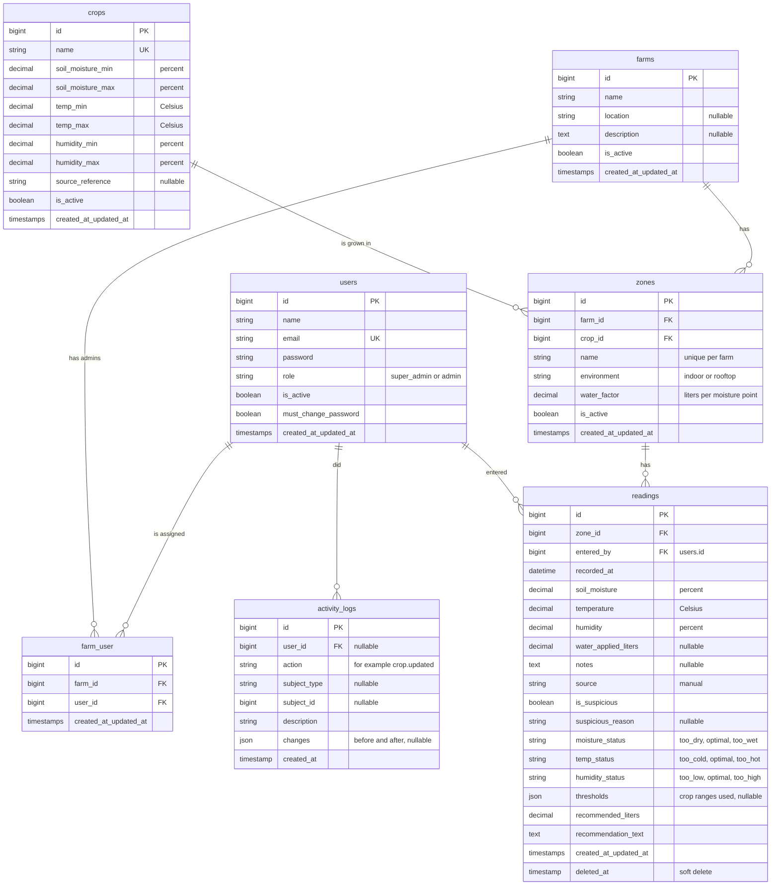

# Sibol ERD

This matches the migrations in `backend/database/migrations`. Laravel's own tables (`cache`, `jobs`, `sessions`, `personal_access_tokens`, `password_reset_tokens`) are left out.

## Relationships

- **users ↔ farms:** many-to-many through `farm_user`. An Admin sees only the farms they are assigned to; a Super Admin sees all farms and needs no assignment.
- **farms → zones:** one farm has many zones.
- **crops → zones:** each zone grows exactly one crop. A crop that is in use cannot be deleted.
- **zones → readings:** one zone has many readings.
- **users → readings:** every reading records who entered it in `entered_by`.
- **users → activity_logs:** each log entry records who made a change. `user_id` is empty for changes made from the command line. `subject_type` and `subject_id` name the record that was changed, without a database-level link, so entries survive whatever happens to that record.

## Rules the schema enforces

- `users.email` and `crops.name` are unique. A zone name is unique within its farm.
- An Admin can be assigned to a farm only once (`farm_user` is unique on `farm_id` + `user_id`).
- Users, farms, crops and zones are retired with `is_active = false`, never deleted. Readings are soft-deleted.
- A reading stores its statuses and recommendation at save time, so editing a crop's thresholds later does not change history. It also stores the ranges it was judged against in `thresholds`, which the trend charts use to draw the band.
- `readings.source` is `manual` for typed-in readings and `csv` for imported ones.
